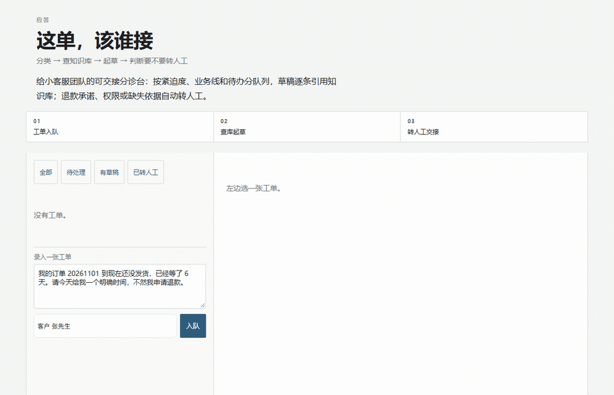
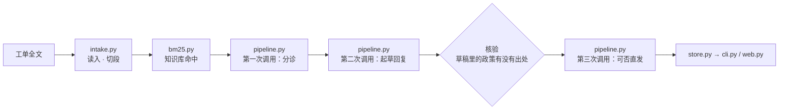

# Yingda · Support Ticket Triage Desk

[](https://github.com/wushiyi105-jpg/yingda/actions) []() [](./LICENSE) [](https://codecov.io/gh/wushiyi105-jpg/yingda)

[](https://github.com/wushiyi105-jpg/yingda/actions/workflows/test.yml)

A triage desk for support tickets. A customer email comes in; it classifies it, searches the knowledge base, writes a draft, then judges for itself whether that draft can go out directly or someone has to take over.

The seventh thing I built. The earlier ones were "do a task for me"; this one is the opposite — most of the time it is holding itself back.



## Why not fully automatic

My first idea was one-click replies to every ticket. Halfway through I found that path is closed: the cost of a support agent saying one wrong sentence is not on the same scale as getting a quiz question wrong. A wrong refund amount costs money, a wrong deadline is a contract breach, a wrong account answer is an incident.

So the default action of this project is "draft + judge", and the send button always belongs to a human. The model does 80% of the labour; the remaining 20% is it raising its own hand to say "this one I cannot hold".

## What it is

One ticket comes in, four steps, and each step is a separate model call:

1. **Triage.** Category (refund / invoice / shipping / account / other), priority P0–P3, customer sentiment. It does not look at the knowledge base here; only at what the customer said.
2. **Retrieval.** BM25 finds relevant passages in the knowledge base. Retrieval is pure program, no tokens.
3. **Drafting.** Ticket plus matched passages go to the model, which must answer using only those passages and must declare what is not covered instead of glossing over it.
4. **Judging.** A different identity — a supervisor — reads the draft. It holds the ticket, the matched passages and the draft, and answers one question: can this be sent?

The judgement splits two ways:

- `drafted`: the draft is usable; a human glances and clicks send.
- `escalated`: hand to a person, with the reason, the missing information, and which team should take it.

Nothing is ever sent automatically. The `send` command is pressed by a person.

## Data flow

How one piece of data moves between the modules:



## Quick start

```bash
git clone https://github.com/wushiyi105-jpg/yingda.git
cd yingda
cp .env.example .env        # Windows: copy .env.example .env
# open .env and put in your own LLM_API_KEY
```

Import the knowledge base, record one ticket, run it:

```bash
python -m yingda kb add samples/kb-退款政策.md samples/kb-物流发票账号.md
python -m yingda intake --file samples/ticket-1-退款.txt --subject "想退掉 11 月买的年费会员"
python -m yingda process --id 1
python -m yingda show 1
```

Output looks roughly like this:

```
=== 工单 [1] → drafted ===
分诊：退款退货 / P1 / 情绪 neutral
知识库命中 4 段 …
草稿：购买后 7 天内、已用容量不超过 1GB 可以申请全额退款，原路退回，3—5 个工作日到账。
      你已用约 300MB，容量条件符合；是否还在 7 天内，我核实下单时间后回复你。
判断：可直接回（无需）—— 草稿引用的三项都能在知识库找到依据，没有编造政策。
```

Start the Web UI:

```bash
python -m yingda serve          # http://127.0.0.1:8767
```

Inbox on the left, full ticket in the middle, draft and judgement reason on the right. "Rerun" walks the pipeline again; "escalate" leaves a record.

Run in Docker (the container uses the default port 8767):

```bash
docker build -t yingda .
docker run -p 8767:8767 yingda
```

## Command reference

| Command | What it does |
| --- | --- |
| `python -m yingda kb add <文件...>` | Import knowledge base (md / txt); re-importing the same source overwrites |
| `python -m yingda kb list` | Show which documents are in the library and how many passages each has |
| `python -m yingda kb rm <来源>` | Delete one |
| `python -m yingda intake --file <文件>` | Record a ticket; .txt and .eml supported |
| `python -m yingda intake --text "正文"` | Paste a body directly |
| `python -m yingda process --id 1` | Run the full pipeline on one ticket |
| `python -m yingda process --limit 10` | Batch over all `new` tickets |
| `python -m yingda list` | Ticket list (status, priority, escalated or not) |
| `python -m yingda show 1` | One ticket end to end: body, triage, matched passages, draft, judgement |
| `python -m yingda send 1` | Human confirmation, marked as replied |
| `python -m yingda escalate 1 --owner 主管` | Hand over manually |
| `python -m yingda stats` | Ticket counts per status, knowledge base size |
| `python -m yingda serve --port 8767` | Start the Web UI |

## What may be sent, what must be human

I revised this line twice; the current rules live in `DECIDE_SYSTEM` inside `pipeline.py`:

Must escalate — refund amount disputes, compensation, legal or regulatory matters; account security (stolen, unusual logins, identity details); the customer explicitly asks for a human; the knowledge base does not cover something that affects the customer's decision; the draft states a policy or promise the knowledge base does not contain; sentiment has escalated into a complaint or a threat to go public.

The reverse is written down too: **do not treat a specific deadline in the draft as overreach**. Support has to say how many days the refund takes; treating "it said a number" as risk pushes every ticket to a human.

## A real rework: 4 tickets, all escalated

This is the most worthwhile part of the project. The first version passed its tests, I ran all 4 sample tickets, and all 4 came back `escalated`. Three of the reasons were obviously wrong:

- Ticket 1 asked "can I get a full refund on the annual membership I bought"; the knowledge base states plainly "within 7 days and under 1GB usage, full refund", and the draft said exactly that — yet the supervisor judged "involves a refund amount, must escalate".
- Ticket 2 asked to change the invoice title; the knowledge base says "can be reissued once within 30 days", the draft quoted that sentence, and the supervisor judged "promised a deadline the knowledge base does not cover".
- Ticket 4's reason was literally "escalation judgement failed, escalating conservatively" — the model produced no JSON.

**Cause one: the supervisor could not see the knowledge base.** All I passed to `decide()` was the number "4 passages matched", not their content. What was it supposed to judge the draft against? Only vibes — and a supervisor accountable for nothing but the draft finds any concrete number dangerous. That is a design error, not a disobedient model.

**Cause two: not enough output budget.** `decide()` had `max_tokens=600`, `deepseek-flash` spent part of it on reasoning, the body was cut off mid-JSON, `json.loads` failed, the fallback took over and chose "escalate conservatively". Ticket 3 was correct (stolen account + threat to go public genuinely needs a human), but correct by luck — it was on the fallback path too.

After both fixes:

- `decide()` now receives every matched passage, with numbers that line up with the citations in the draft.
- The prompt gained a hard rule: overreach is judged against the passages; a deadline, amount or percentage found there counts as grounded, and only what is not found counts against it. Plus "do not escalate just because a number is mentioned".
- `max_tokens` raised to 1200, keeping the client's doubling retry.

Same batch again: 4 became 3 `drafted` + 1 `escalated`. Ticket 3 still escalates, but the reason changed from "fallback" to something specific: account stolen, foreign login alert, customer pressuring via Weibo and Black Cat complaints, the knowledge base only covers "freeze first, verify identity, reply within 7 working days", and says nothing about whether files can be recovered.

That is the behaviour I wanted: **every ticket it stops, it can explain why.**

I also fixed something small: `stats` only counted `new / replied / escalated`, the `drafted` bucket did not exist, so 3 drafts vanished from the stats and looked like lost tickets.

## 🤔 Why not just ask a general LLM

A general model will happily write a support reply. Yingda adds the three things it cannot:

1. **It decides whether the reply may go out** — after drafting, it judges "safe to send" versus "a human must take over": every policy cited must be findable in the knowledge base, otherwise it escalates. A chat model always thinks its draft is fine.
2. **The basis can be checked** — triage result, matched knowledge-base passages and each citation in the draft are listed, so a person can see which document a sentence came from instead of trusting a feeling.
3. **Tickets and knowledge stay local** — incoming mail, ticket states and knowledge documents sit on this machine; a model call sends the current message and matched passages only.
4. **Structured output** — category, priority, sentiment, draft and the reason for the verdict are fixed fields you can tabulate and chart; a chat reply is one block of text with no triage board.

## 🎯 Use cases

- **A support lead triaging a queue**: incoming messages sorted by category and priority, the safe ones sent first, the uncertain ones left for a human, with the order visible at a glance.
- **A small team without a ticket system**: three to five people answering support mail can paste a message in and get a draft with its sources, instead of each person re-reading policy.
- **Training a new hire**: let it draft alongside, then compare against the knowledge-base passages to see which policy was missed — steadier than reading the onboarding docs once.

## 🗺 Roadmap

- **Ticket state transitions**: add pending / replied / escalated / closed with a record of each change.
- **Similar-ticket retrieval**: surface how the same question was answered last time.
- **Knowledge gap stats**: count questions that hit nothing, and use that to decide which documents to write.
- **Tone per brand**: the same policy in different voices per business line, configured rather than hand-edited.
- **Weekly export**: triage volume, auto-send rate and escalation reasons as Markdown.

## ❓ FAQ

**Where do I get an API key?**
The project ships without one. It talks to DeepSeek (`https://api.deepseek.com`) by default — set `LLM_API_KEY`. Any OpenAI-compatible endpoint works.

**Where is data stored, and is it uploaded?**
Tickets, knowledge base and verdict records live in local SQLite (default `data/yingda.db`); a model call sends the current message and matched passages.

**Does it work without a key?**
You can record tickets and browse the knowledge base, but triage and drafting need a model; offline it will not invent a reply.

**How do I switch models?**
Change `LLM_BASE_URL`, `LLM_MODEL` and `LLM_API_KEY` as in `.env.example`; the judgement logic is unchanged.

**Why was this one escalated?**
The draft cited a policy that cannot be found in the knowledge base, or the message involves refunds or liability that an automatic reply should not settle. The reason is written on the ticket.

## Layout

```
yingda/
├── yingda/
│   ├── text.py     paragraph splitting, tokenising, HTML tag stripping
│   ├── bm25.py     BM25 retrieval (Chinese single characters + bigrams)
│   ├── store.py    SQLite: tickets / kb / event log, status transitions
│   ├── intake.py   ticket intake (.eml parsing, pasted text)
│   ├── pipeline.py triage → retrieve → draft → judge, three separate calls
│   ├── llm.py      OpenAI-compatible client (urllib only)
│   ├── cli.py      command line
│   └── web.py      http.server inbox page + JSON endpoints
├── samples/        2 knowledge base docs, 4 tickets (one .eml)
├── tests/          36 offline unit tests
├── scripts/        usage GIF generator (dev only, needs Pillow)
└── assets/demo.gif
```

## Tests

```bash
python -m unittest discover -s tests -v
```

36 cases, all offline: no network, no tokens. Model calls are mocked, covering chunking and tokenising, BM25 ranking, six status transitions, `.eml` parsing (including mojibake in Chinese attachments), failure fallbacks across all three calls (any model error escalates), and the five Web endpoints.

CI runs Python 3.10–3.13, see the badge above.

## Things I got wrong

**Chinese in `.eml` came out as mojibake.** I started with `get_content()`, and Chinese mail decoded into a pile of `=?utf-8?B?`. Changed to `get_payload(decode=True)` for raw bytes, then decode as utf-8 with latin-1 as a fallback.

**The same model, a different identity, behaves differently.** Triage, drafting and judging are three separate calls with their own system prompts. I tried merging them into one call doing all three; the result was that while writing the draft it was already building its own justification, and "can this be sent" stopped working entirely. Separate calls cost a bit more and keep the judgement independent.

**When the model fails, fall to the conservative side.** Any step raising means the pipeline escalates, with the reason "model call failed, escalating conservatively". Better no reply than a wrong one. That fallback is what fired on ticket 4 — it masked the real bug (budget), but in that moment it was right.

**Never set a threshold on an absolute score.** Learned on the previous project (Zhiku) and inherited directly: a query bigram has to hit at least once to be a candidate, the score is only for ordering.

## Author

shiyi · wushiyi105@gmail.com · [@wushiyi105-jpg](https://github.com/wushiyi105-jpg)

## License

MIT
