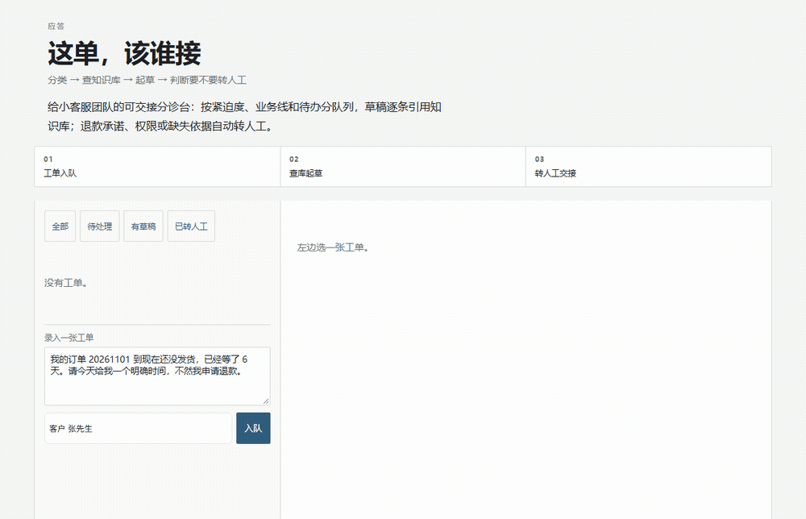
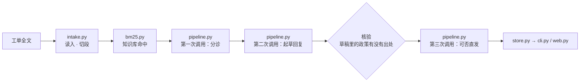

# 应答 · Yingda

[](https://github.com/wushiyi105-jpg/yingda/actions) []() [](./LICENSE) [](https://codecov.io/gh/wushiyi105-jpg/yingda)

[](https://github.com/wushiyi105-jpg/yingda/actions/workflows/test.yml)

一个客服工单的分诊台。客户来信进来，它先分类、查知识库、写一份草稿，然后自己判断：这份草稿能不能直接发出去，还是必须有人接。

我做的第 7 个东西。前面几个都是"帮我干一件事"，这个反过来——它大部分时候在拦自己。



## 为什么不是全自动

我先想的是一键回完所有工单。写了半天发现这条路不通：客服回错一句话的代价，跟答错一道题完全不是一个量级。退款金额说错了要赔钱，时限说错了是违约，账号问题说错了是事故。

所以这个项目的默认动作是「起草 + 判断」，发送那一下永远留给人。模型负责把 80% 的力气活干完，剩下 20% 由它自己举手说「这个我接不住」。

## 它是什么

一张工单进来，走四步，每一步都是一次独立的模型调用:

1. **分诊**：分类（退款退货 / 发票 / 物流 / 账号 / 其他）、优先级 P0–P3、客户情绪。这一步不看知识库，只看客户说了什么。
2. **检索**：BM25 在知识库里找相关段落。检索是纯程序，不花 token。
3. **起草**：把工单 + 命中的段落给模型，要求它只用这些段落回答，没覆盖到的地方必须自己交代出来，不许糊过去。
4. **判断**：换一个身份——主管——来看这份草稿。它手里有工单、有命中段落、有草稿，任务是回答一个问题：能发吗？

判断结果分两条路：

- `drafted`：草稿可以用，人过一眼点发送。
- `escalated`：转人工，附上转的理由、还缺什么信息、该给哪个组。

没有任何一条路会自动发出去。`send` 这个命令是人按的。

## 数据流

一条数据在这几个模块之间怎么走：



## 快速开始

```bash
git clone https://github.com/wushiyi105-jpg/yingda.git
cd yingda
cp .env.example .env        # Windows: copy .env.example .env
# 打开 .env，把 LLM_API_KEY 换成你自己的
```

导入知识库，录一张工单，跑一遍：

```bash
python -m yingda kb add samples/kb-退款政策.md samples/kb-物流发票账号.md
python -m yingda intake --file samples/ticket-1-退款.txt --subject "想退掉 11 月买的年费会员"
python -m yingda process --id 1
python -m yingda show 1
```

跑出来大概是这样：

```
=== 工单 [1] → drafted ===
分诊：退款退货 / P1 / 情绪 neutral
知识库命中 4 段 …
草稿：购买后 7 天内、已用容量不超过 1GB 可以申请全额退款，原路退回，3—5 个工作日到账。
      你已用约 300MB，容量条件符合；是否还在 7 天内，我核实下单时间后回复你。
判断：可直接回（无需）—— 草稿引用的三项都能在知识库找到依据，没有编造政策。
```

起 Web 界面：

```bash
python -m yingda serve          # http://127.0.0.1:8767
```

左边收件箱，中间工单全文，右边草稿和判断理由。点「重跑」会重新走一遍管线，点「转人工」留个记录。

Docker 运行(容器内用默认端口 8767):

```bash
docker build -t yingda .
docker run -p 8767:8767 yingda
```

## 🤔 为什么不用通用大模型直接问

通用模型能替你写一封客诉回复,但信使补的是它做不到的三件事:

1. **先判断能不能发** —— 草稿写完后,它自己判断「可直接回」还是「必须人接」:引用的政策必须能在知识库里找到依据,找不到就转人工。通用模型永远觉得自己写得挺好。
2. **依据可核** —— 分诊结果、命中的知识库段落、草稿里引用的依据逐条列出,人能看见「这句话是从哪份文档来的」,而不是凭感觉相信。
3. **工单与知识库在本地** —— 客户来信、工单状态、知识库文档都存在本机,不外传;调模型时只发当前这封和命中的段落。
4. **结构化输出** —— 分类、优先级、情绪、草稿、判断理由都是固定字段,能进表格、能统计;通用对话是一段文字,没法做分诊看板。

## 🎯 适用场景

- **客服主管做分流**:一批来信进来,先按分类与优先级排,能直发的先发,拿不准的留给人工,处理顺序一目了然。
- **小团队没有工单系统**:三五个人用一封邮件接客服,把来信贴进来,草稿和依据一起出来,不用每个人从头查政策。
- **新人练回复**:让它在旁边写一版草稿,对照知识库段落看自己漏了哪条政策,比看完培训材料就上岗稳。

## 🗺 Roadmap

- **工单状态流转**:新增「待处理 / 已回复 / 已转人工 / 已关闭」,并记录每次变更。
- **相似工单检索**:同一类问题自动带出上次怎么回的,减少重复劳动。
- **知识库缺口统计**:统计哪些问题命不中知识库,反过来指导补文档。
- **按品牌调语气**:同一套政策,不同业务线用不同口吻,配置化而不是每次手改。
- **周报导出**:把一周的分诊量、直发率、转人工原因导成 Markdown。

## ❓ FAQ

**API key 从哪来?**
项目不带 key。默认接 DeepSeek(`https://api.deepseek.com`),注册后填 `LLM_API_KEY`;也支持任何 OpenAI 兼容端点。

**数据存在哪,会上传吗?**
工单、知识库和判断记录在本地 SQLite(默认 `data/yingda.db`);调模型时只发当前来信与命中的知识库段落。

**没有 key 能不能用?**
能录入、能看工单和知识库,但分诊与草稿要模型;离线时不会替你编一封回信。

**怎么换模型?**
改 `LLM_BASE_URL`、`LLM_MODEL`、`LLM_API_KEY`,见 `.env.example`;判断逻辑不变。

**为什么这封被判「必须人接」?**
草稿引用的政策在知识库里找不到依据,或者涉及退款金额、责任认定这类不该由自动回复拍板的内容。判断理由会写在工单上。

## 命令参考

| 命令 | 作用 |
| --- | --- |
| `python -m yingda kb add <文件...>` | 导入知识库（md / txt），同一来源再导入会覆盖 |
| `python -m yingda kb list` | 看库里有哪几篇、各多少段 |
| `python -m yingda kb rm <来源>` | 删一篇 |
| `python -m yingda intake --file <文件>` | 录入工单，支持 .txt 和 .eml |
| `python -m yingda intake --text "正文"` | 直接粘一段进来 |
| `python -m yingda process --id 1` | 跑单张工单的完整管线 |
| `python -m yingda process --limit 10` | 批量跑所有 `new` 的工单 |
| `python -m yingda list` | 工单列表（含状态、优先级、是否转人工） |
| `python -m yingda show 1` | 一张工单的全过程：原文、分诊、命中段落、草稿、判断 |
| `python -m yingda send 1` | 人工确认，标记为已回复 |
| `python -m yingda escalate 1 --owner 主管` | 手动转人工 |
| `python -m yingda stats` | 各状态工单数、知识库规模 |
| `python -m yingda serve --port 8767` | 起 Web |

## 什么能直发，什么必须人接

这条线我改过两版，现在的规则写在 `pipeline.py` 的 `DECIDE_SYSTEM` 里：

必须转人工的情况——涉及退款金额争议、赔偿、法律或监管；账号安全（被盗、异常登录、实名信息）；客户明确要求人工；知识库完全没覆盖而回答又影响客户决策；草稿里出现了知识库没有的政策或承诺；情绪已经升级成投诉、威胁曝光。

反过来也写清楚了：**不要因为草稿提到具体时限就判越权**。客服本来就要说清几天到账，把"说了数字"当成风险，等于把所有工单都推给人。

## 一次真实的返工：4 张工单，全被转人工

这是这个项目最值得写的一段。第一版跑通，我把 4 张样例工单全跑了一遍，结果 4 张全部 `escalated`。其中 3 张的理由明显不对：

- 工单 1 问「买了年费会员能全额退吗」，知识库白纸黑字写着「7 天内且用量不超过 1GB 全额退」，草稿也照着实说了，主管却判「涉及退款金额，必须转人工」。
- 工单 2 问发票改抬头，知识库写着「30 天内可重开一次」，草稿引的就是这句，主管判「承诺了知识库未覆盖的时限」。
- 工单 4 的转人工理由直接是「升级判断失败，按保守策略转人工」——模型没吐出 JSON。

**病因一：主管看不到知识库。** 我给 `decide()` 的输入只有「知识库命中 4 段」这个数字，没有那 4 段的内容。它拿什么判断草稿有没有依据？只能靠感觉，而一个只对草稿负责的主管，看到任何具体数字都会觉得危险。这是设计错误，不是模型不听话。

**病因二：输出的地方没留够预算。** `decide()` 当时 `max_tokens=600`，`deepseek-flash` 先花一截在推理上，正文还没输出完就被截断，`json.loads` 自然失败，兜底逻辑接手，判「保守转人工」。工单 3 是对的（账号被盗 + 威胁曝光，本来就要人接），但它对得有点侥幸——那时它也在走兜底。

两处改完:

- `decide()` 的输入里补上命中的每一段正文，带编号，和草稿里引的编号对得上。
- 提示词加一条硬规则：判断越权以片段为准，片段里能找到的时限、金额、比例算有依据；找不到才算。同时把「不要因为提到数字就转人工」写进去。
- `max_tokens` 提到 1200，客户端的翻倍重试保留。

改完再跑同一批，4 张变成 3 张 `drafted` + 1 张 `escalated`。工单 3 仍然转人工，理由从「兜底」变成了具体的：账号被盗、境外登录提醒、客户以微博和黑猫投诉施压、知识库只覆盖到「先冻结、核验实名、7 个工作日答复」，对「文件能否恢复」完全没写。

这才是我想要的行为：**它拦下来的每一条，都能说清为什么拦。**

顺手还修了个小的：`stats` 只统计了 `new / replied / escalated` 三个状态，`drafted` 那条计数根本不存在，3 张草稿在统计里凭空消失，看着像丢单。

## 目录结构

```
yingda/
├── yingda/
│   ├── text.py     段落切分、分词、HTML 去标签
│   ├── bm25.py     BM25 检索（中文单字 + 二元组）
│   ├── store.py    SQLite：tickets / kb / 事件记录、状态流转
│   ├── intake.py   工单录入（.eml 解析、粘贴文本）
│   ├── pipeline.py 分诊 → 检索 → 起草 → 判断，三次独立调用
│   ├── llm.py      OpenAI 兼容客户端（零依赖 urllib）
│   ├── cli.py      命令行
│   └── web.py      http.server 收件箱页面 + JSON 接口
├── samples/        2 篇知识库、4 张工单（含 1 个 .eml）
├── tests/          36 个离线单测
├── scripts/        生成示例 GIF（开发期用，需 Pillow）
└── assets/demo.gif
```

## 测试

```bash
python -m unittest discover -s tests -v
```

36 个用例，全部离线:不联网、不花 token。模型调用在测试里被 mock 掉，覆盖了切块与分词、BM25 排序、六种状态流转、`.eml` 解析（含中文附件乱码）、三次调用的失败兜底（模型报错一律转人工）、以及 Web 的五个接口。

CI 跑 Python 3.10–3.13，见上方徽章。

## 几个踩过的坑

**`.eml` 里的中文全是乱码。** 一开始用 `get_content()` 拿正文，中文邮件解出来是一堆 `=?utf-8?B?`。改成先 `get_payload(decode=True)` 拿到原始字节，再按 utf-8 解、失败退回 latin-1，才正常。

**同一个模型，换个身份就不一样了。** 分诊、起草、判断是三次独立调用，各自有各自的 system prompt。我试过合成一次调用让它同时干三件事，结果它写草稿的时候已经在替自己找理由了，「能不能发」这个判断彻底失效。分开调，钱多花一点，判断才独立。

**模型失败时必须往保守方向倒。** 任何一步抛异常，管线直接判 `escalated`，理由写「模型调用失败，按保守策略转人工」。宁可不回，不可回错。工单 4 那次就是这个兜底在起作用——虽然它掩盖了真正的 bug（预算不够），但那一刻它是对的。

**阈值别按分数绝对值定。** 这条是上一个项目（知库）踩过的，这里直接继承：查询里的二元组至少命中一个才算候选，分数只用来排序。

## 作者

shiyi · wushiyi105@gmail.com · [@wushiyi105-jpg](https://github.com/wushiyi105-jpg)

## License

MIT
